# Project Chunker

High-density project snapshotting, atomic archive-and-scoop (`--scoop`), multi-version registry tracking, dual repo safety protection, and zero-SQL web workstation for Linux and Termux environments.

`Project Chunker` provides an end-to-end framework for capturing complete workspace state into portable, deterministic BEJSON 104a snapshot containers. It eliminates unmanaged filesystem drift through single-file containerization, verified SHA-256 byte reconciliation, automated packaging versioning, dual repository safety enforcement, and integrated local web workstations.

---

## Table of Contents
- [1. Executive Overview & System Invariants](#1-executive-overview--system-invariants)
  - [1.1 Core Purpose & Problem Statement](#11-core-purpose--problem-statement)
  - [1.2 Fundamental Architecture Invariants](#12-fundamental-architecture-invariants)
  - [1.3 Design Non-Goals & Scope Boundaries](#13-design-non-goals--scope-boundaries)
- [2. Prerequisites & Environment Setup](#2-prerequisites--environment-setup)
  - [2.1 Operating System & Hardware Support](#21-operating-system--hardware-support)
  - [2.2 Runtime Dependencies & Python Version](#22-runtime-dependencies--python-version)
  - [2.3 Environment Variable Configuration](#23-environment-variable-configuration)
  - [2.4 Filesystem Permissions & Storage Partitions](#24-filesystem-permissions--storage-partitions)
- [3. Installation & Initial Health Check](#3-installation--initial-health-check)
  - [3.1 Repository Cloning & Setup](#31-repository-cloning--setup)
  - [3.2 Storage Layout Initialization](#32-storage-layout-initialization)
  - [3.3 Initial Integrity Audit](#33-initial-integrity-audit)
- [4. Operational Interfaces](#4-operational-interfaces)
  - [4.1 Command Line Interface (`CLI/project_chunker.py`)](#41-command-line-interface-cliproject_chunkerpy)
  - [4.2 Interactive Terminal Menu (`Menu/project_chunker_menu.py`)](#42-interactive-terminal-menu-menuproject_chunker_menupy)
  - [4.3 Unified Web Workstation (`Web/project_chunker_flask.py`)](#43-unified-web-workstation-webproject_chunker_flaskpy)
  - [4.4 Standalone Project Viewer (`Web/project_management_flask.py`)](#44-standalone-project-viewer-webproject_management_flaskpy)
- [5. Core Workflows & Operational Recipes](#5-core-workflows--operational-recipes)
  - [5.1 Deterministic Snapshot Chunking (`--chunk`)](#51-deterministic-snapshot-chunking---chunk)
  - [5.2 Atomic Archive-and-Scoop (`--scoop`)](#52-atomic-archive-and-scoop---scoop)
  - [5.3 Byte-Perfect Project Restoration (`--restore`)](#53-byte-perfect-project-restoration---restore)
  - [5.4 Project Type & Status Combobox Filtering](#54-project-type--status-combobox-filtering)
  - [5.5 Dual Repository Collision Protection](#55-dual-repository-collision-protection)
  - [5.6 Explicit Version & Package Sequencing](#56-explicit-version--package-sequencing)
  - [5.7 System Backups & Disaster Recovery (`--backup`)](#57-system-backups--disaster-recovery---backup)
  - [5.8 Storage Schema In-Place Migration (`--migrate`)](#58-storage-schema-in-place-migration---migrate)
  - [5.9 Storage Pool Integrity Auditing (`--verify`)](#59-storage-pool-integrity-auditing---verify)
  - [5.10 Exclusion & Inclusion Filter Switches](#510-exclusion--inclusion-filter-switches)
  - [5.11 Snapshot Replacement Conflict Strategies](#511-snapshot-replacement-conflict-strategies)
- [6. Visual Interface Tour](#6-visual-interface-tour)
  - [6.1 Unified Dashboard](#61-unified-dashboard)
  - [6.2 Projects Registry & Combobox Filters](#62-projects-registry--combobox-filters)
  - [6.3 Chunk, Track & Scoop Console](#63-chunk-track--scoop-console)
  - [6.4 Snapshot Restoration Console](#64-snapshot-restoration-console)
  - [6.5 Storage Schema Migrator](#65-storage-schema-migrator)
  - [6.6 Storage Integrity Verifier](#66-storage-integrity-verifier)
  - [6.7 Filter Configuration Switches](#67-filter-configuration-switches)
  - [6.8 Background Jobs & Telemetry Log](#68-background-jobs--telemetry-log)
  - [6.9 Application Settings & Storage Paths](#69-application-settings--storage-paths)
  - [6.10 System Specification & About View](#610-system-specification--about-view)
- [7. System Architecture & Subsystem Layout](#7-system-architecture--subsystem-layout)
  - [7.1 6-Tier Directory Tree](#71-6-tier-directory-tree)
  - [7.2 Storage Pool Organization & Partitioning](#72-storage-pool-organization--partitioning)
  - [7.3 Process Concurrency & Atomic Lock Protocols](#73-process-concurrency--atomic-lock-protocols)
  - [7.4 View Model & Cache Architecture](#74-view-model--cache-architecture)
- [8. BEJSON Tabular Schemas & Data Specifications](#8-bejson-tabular-schemas--data-specifications)
  - [8.1 Snapshot Entity Schema (`SnapshotEntity` v2.1)](#81-snapshot-entity-schema-snapshotentity-v21)
  - [8.2 Master Registry Schema (`RegistryRecord` v3)](#82-master-registry-schema-registryrecord-v3)
  - [8.3 Project Tracker Schema (`TrackerRecord` v1)](#83-project-tracker-schema-trackerrecord-v1)
  - [8.4 Web Jobs Telemetry Schema (`WebJobRecord` v1)](#84-web-jobs-telemetry-schema-webjobrecord-v1)
  - [8.5 Project Manifest Format (`bejson_project.json`)](#85-project-manifest-format-bejson_projectjson)
  - [8.6 Filter Configuration Format (`chunker_filters.json`)](#86-filter-configuration-format-chunker_filtersjson)
  - [8.7 Web Server Configuration Format (`web_config.json`)](#87-web-server-configuration-format-web_configjson)
- [9. Internal Library API Reference](#9-internal-library-api-reference)
  - [9.1 `lib_bejson_Core_bejson_core.py`](#91-lib_bejson_core_bejson_corepy)
  - [9.2 `lib_bejson_Core_bejson_validator.py`](#92-lib_bejson_core_bejson_validatorpy)
  - [9.3 `lib_bejson_Projects_paths.py`](#93-lib_bejson_projects_pathspy)
  - [9.4 `lib_bejson_Projects_tracker.py`](#94-lib_bejson_projects_trackerpy)
  - [9.5 `lib_bejson_Projects_registry.py`](#95-lib_bejson_projects_registrypy)
  - [9.6 `lib_bejson_Projects_snapshot.py`](#96-lib_bejson_projects_snapshotpy)
  - [9.7 `lib_bejson_Projects_pipeline.py`](#97-lib_bejson_projects_pipelinepy)
  - [9.8 `lib_bejson_Projects_view.py`](#98-lib_bejson_projects_viewpy)
  - [9.9 `lib_bejson_Projects_filters.py`](#99-lib_bejson_projects_filterspy)
  - [9.10 `lib_bejson_Projects_locks.py`](#910-lib_bejson_projects_lockspy)
  - [9.11 `lib_bejson_Projects_backup.py`](#911-lib_bejson_projects_backuppy)
  - [9.12 `lib_bejson_Projects_logging.py`](#912-lib_bejson_projects_loggingpy)
- [10. Command Line Interface (CLI) Complete Reference](#10-command-line-interface-cli-complete-reference)
  - [10.1 Complete Options & Flag Matrix](#101-complete-options--flag-matrix)
  - [10.2 Return & Exit Codes](#102-return--exit-codes)
  - [10.3 Scripting & Shell Pipeline Recipes](#103-scripting--shell-pipeline-recipes)
- [11. Web Workstations & REST API Reference](#11-web-workstations--rest-api-reference)
  - [11.1 Server Discovery & Dynamic Port Allocation](#111-server-discovery--dynamic-port-allocation)
  - [11.2 Security & CSRF Token Architecture](#112-security--csrf-token-architecture)
  - [11.3 Complete REST API Endpoints Specification](#113-complete-rest-api-endpoints-specification)
  - [11.4 cURL Workflow Examples & Payload Contracts](#114-curl-workflow-examples--payload-contracts)
- [12. Antigravity System Integration](#12-antigravity-system-integration)
  - [12.1 Lifecycle Hook Handler (`project_chunker_hook.py`)](#121-lifecycle-hook-handler-project_chunker_hookpy)
  - [12.2 Declarative Subagent (`project-chunk-manager.md`)](#122-declarative-subagent-project-chunk-managermd)
- [13. Testing, Conformance & Verification Suites](#13-testing-conformance--verification-suites)
  - [13.1 Conformance & Unit Test Suite (`test_project_chunker.py`)](#131-conformance--unit-test-suite-test_project_chunkerpy)
  - [13.2 System Backup Integrity Test Suite (`test_project_backup.py`)](#132-system-backup-integrity-test-suite-test_project_backuppy)
  - [13.3 Playwright End-to-End Browser Test Suite (`test_project_chunker_playwright.py`)](#133-playwright-end-to-end-browser-test-suite-test_project_chunker_playwrightpy)
- [14. Troubleshooting & Diagnostic Reference](#14-troubleshooting--diagnostic-reference)
  - [14.1 Diagnostic Failure Matrix](#141-diagnostic-failure-matrix)
  - [14.2 Corrupt Snapshot Recovery Protocols](#142-corrupt-snapshot-recovery-protocols)
- [15. Maintenance & Credits](#15-maintenance--credits)

---

## 1. Executive Overview & System Invariants

### 1.1 Core Purpose & Problem Statement

Managing multiple concurrent repositories and development experiments on local workstations and Android Termux environments presents distinct storage and operational challenges:
- **Accumulated Workspace Drift**: Abandoned branches, partial refactors, compiled intermediate objects, and untracked scratch scripts consume limited storage.
- **Accidental Workspace Destruction**: Unchecked recursive directory deletion commands (`rm -rf`) cause irreversible source code loss when run against uncommitted or unarchived repositories.
- **Split-Brain Workspace Divergence**: Developers frequently clone or unpack duplicate copies of a project into disparate staging directories, leading to confusion over which directory represents the canonical source of truth.
- **Archive Opacity & Lock-In**: Standard compressed archive formats (`.tar.gz`, `.tar.xz`, `.zip`) hide file lists, modification timestamps, and metadata inside compressed binary streams, preventing immediate inspection, SQL-free querying, and programmatic cataloging without full extraction to disk.

`Project Chunker` provides an integrated, verified lifecycle management framework. It packages full codebase trees into human-readable, schema-validated BEJSON 104a snapshot containers, guarantees byte-for-byte reconciliation before any source deletion, enforces single-canonical-path repository invariants, and exposes complete management capabilities across both terminal and web interfaces.

### 1.2 Fundamental Architecture Invariants

`Project Chunker` enforces six foundational system invariants across all CLI and web operations:

1. **Non-Destructive Archival Invariant**: The `--scoop` workflow NEVER deletes a source directory until the generated snapshot is written to disk, re-read, and validated byte-for-byte against the live filesystem. If a single byte or checksum differs, the operation aborts and leaves all source files intact.
2. **Deterministic Document Structure**: All data tables (`registry.bejson`, snapshot containers, tracker files, and web logs) strictly adhere to the BEJSON 104a tabular specification:
   - Header dictionary containing `Format`, `Format_Version`, `Records_Type`, and `Fields`.
   - O(1) field map caching indexing column names to array positions. Positional hardcoded index lookups are strictly prohibited.
3. **Dual Repository Protection Invariant**: The first time a project is tracked, its absolute path is permanently recorded as `Official_Path`. Subsequent chunk, scoop, or track operations targeting an alternate path for the same project trigger a `DUAL REPO ALERT`, requiring explicit override confirmation to prevent split-brain workspace corruption.
4. **Solid Versioning Standard**: Version numbers and package counters are monotonically incremented solid integers or semantic sequences (e.g., `1.9.0`, `PKG115`), preventing ambiguously ordered releases.
5. **Atomic Filesystem Mutation**: Every write operation writes first to a temporary staging file (`<target>.tmp.<pid>`), flushes buffers, and executes an atomic POSIX rename under an active PID directory lock (`<path>.lockdir`).
6. **Zero-Fluff UI & Data Discipline**: User-facing titles, labels, badges, and export artifacts define purely what the component does by its literal purpose without architectural metaphors or marketing claims.

### 1.3 Design Non-Goals & Scope Boundaries

To maintain long-term reliability and architectural clarity, `Project Chunker` defines explicit boundaries:
- **Not a Distributed VCS**: It does not replace Git or Mercurial for branch merging, three-way diffing, or remote multi-developer collaborative push/pull workflows.
- **Not a Cloud Storage Client**: It does not embed cloud vendor SDKs (AWS S3, Google Cloud Storage, Azure Blob). Storage management is local-first, POSIX-compliant, and self-contained.
- **Not an Arbitrary Archive Transcoder**: It specifically formats workspaces into BEJSON 104a tabular snapshot containers rather than generic archive formats.

---

## 2. Prerequisites & Environment Setup

### 2.1 Operating System & Hardware Support

`Project Chunker` is engineered for POSIX environments with dedicated optimization for Linux distributions and Android Termux:
- **Linux (x86_64, aarch64, armv7l)**: Ubuntu 20.04+, Debian 11+, Fedora, Arch Linux, Alpine Linux.
- **Android Termux (arm64-v8a, armeabi-v7a, x86_64)**: Native Termux environment with internal app storage and shared storage access (`termux-setup-storage`).
- **Memory Requirements**: Minimum 128 MB RAM for CLI operations; 256 MB RAM recommended for web workstation and Playwright test execution.
- **Storage**: Minimum 50 MB free disk space for the runtime and test suites, plus storage capacity matching target project snapshot pools.

### 2.2 Runtime Dependencies & Python Version

#### Python Standard Library (Python 3.10+)
The entire core pipeline (`lib/` and `CLI/`) relies strictly on standard Python libraries:
- `argparse`: Command line flag parsing, type validation, and auto-generated help.
- `hashlib`: SHA-256 calculation for file contents, raw byte streams, and snapshot reconciliation.
- `json`: Structured parsing and serialization of BEJSON tabular documents.
- `pathlib`: Portable object-oriented filesystem path manipulation.
- `shutil`: Recursive file copying and directory removal during scoop.
- `zipfile`: ZIP archive intake and export generation.
- `urllib.request`: Health check probing and server readiness detection.
- `socket`: Dynamic port scanning and network socket binding.
- `dataclasses`: Lightweight structured data transfer objects.
- `typing`: Static typing annotations (`Optional`, `Dict`, `List`, `Tuple`, `Any`).

#### External Dependencies
- **Flask (v2.0+)**: Powers `Web/project_chunker_flask.py` and `Web/project_management_flask.py`.
- **Pillow (v9.0+)**: Powers documentation image optimization and thumbnail rendering.
- **Playwright / Termux Playwright (v1.30+)**: Optional dependency for executing automated headless browser verification.

To install external dependencies:

```bash
pip install flask pillow
```

### 2.3 Environment Variable Configuration

`Project Chunker` supports dynamic environment configuration. Define these in your shell configuration (`~/.bashrc`, `~/.zshrc`, or Termux profile):

| Environment Variable | Purpose | Default Resolution |
|:---|:---|:---|
| `PROJECT_CHUNKER_STORAGE_ROOT` | Overrides the master storage directory | `<project_root>/storage` |
| `PROJECT_TYPE_LEDGER` | Points to the canonical Project Type Ledger file | Auto-detected from user definitions |
| `LOGGING_TOOL` | Points to the ecosystem logging script | Auto-detected or skipped |
| `PAGER` | Terminal pager for CLI help output | Automatically set to `cat` in automation |

Example shell configuration snippet:

```bash
# Set custom storage directory for snapshot pools
export PROJECT_CHUNKER_STORAGE_ROOT="$HOME/project_chunker_storage"

# Set canonical project type ledger
export PROJECT_TYPE_LEDGER="$HOME/.env/user/project_type_ledger.104a.bejson"
```

### 2.4 Filesystem Permissions & Storage Partitions

- **ext4 / F2FS (Termux internal `$HOME`)**: Full support for POSIX file permissions, atomic directory locking, symlinks, and directory modified time preservation.
- **FAT32 / exFAT / SDCard (`/storage/emulated/0`)**: Supports all core storage operations. File permission bits (`chmod`) are non-enforceable on emulated storage; `Project Chunker` detects this condition gracefully without raising fatal errors.

---

## 3. Installation & Initial Health Check

### 3.1 Repository Cloning & Setup

Clone the repository into your preferred workspace directory:

```bash
# Clone repository
git clone https://github.com/boehnenelton/Project_Chunker.git
cd Project_Chunker

# Ensure scripts have execute permissions
chmod +x CLI/project_chunker.py
chmod +x Menu/project_chunker_menu.py
chmod +x Web/project_chunker_flask.py
chmod +x Web/project_management_flask.py
```

### 3.2 Storage Layout Initialization

When executed for the first time, `Project Chunker` initializes the standard storage layout automatically under the target storage root:

```
storage/
├── master/
│   └── data/
│       └── registry.bejson         # Master catalog of all registered projects
├── trackers/
│   └── data/                       # Historical per-project tracker databases
├── project_snapshots/              # Individual project snapshot partitions
├── backups/                        # System-wide snapshot archive ZIPs
└── superseded/                     # Historical snapshots replaced during updates
```

To explicitly initialize or re-verify storage layout directories:

```bash
python3 -c "from pathlib import Path; from lib.lib_bejson_Projects_paths import projects_paths_resolve_storage_layout; projects_paths_resolve_storage_layout(Path('.'))"
```

### 3.3 Initial Integrity Audit

Execute the storage integrity audit to verify directory structure and registry linkage:

```bash
python3 CLI/project_chunker.py --verify
```

Expected output for a clean storage installation:
```
Audit Results:
  Total Registry Rows:       35
  Valid Snapshots Found:     35
  Missing Snapshots:         0
  Unreadable Snapshots:      0
  Mismatched Checksums:      0
[PASS] Storage integrity verified with 0 errors.
```

---

## 4. Operational Interfaces

`Project Chunker` provides four purpose-built interfaces sharing the same underlying `lib/` modules.

### 4.1 Command Line Interface (`CLI/project_chunker.py`)
Direct command-line tool designed for headless execution, automated CI/CD pipelines, shell scripts, and cron maintenance jobs.
- **Entry point**: `CLI/project_chunker.py`
- **Output modes**: Human-readable standard output or machine-parseable JSON (`--json`).
- **Exit codes**: Standardized non-zero status codes for predictable script integration.

```bash
# Basic CLI invocation syntax
python3 CLI/project_chunker.py --chunk /path/to/project --type python
```

### 4.2 Interactive Terminal Menu (`Menu/project_chunker_menu.py`)
A keyboard-driven terminal user interface designed for mobile Termux sessions and small SSH windows:
- **Discipline**: Strictly constrained to 57 columns for vertical portrait smartphone screens.
- **Navigation**: Arrow keys (`Up`/`Down`) for cursor navigation, `Enter` to select, `Esc` or `q` to return.
- **Capabilities**: Interactive project tracking, snapshot chunking, scoop archival, restore selection, and storage integrity audits without manual path typing.

```bash
# Launch interactive terminal interface
python3 Menu/project_chunker_menu.py
```

### 4.3 Unified Web Workstation (`Web/project_chunker_flask.py`)
The primary graphic workstation providing comprehensive management across 10 unified pages:
- **Dynamic Port Selector**: Scans starting at port 5140 to locate an unbound socket.
- **Asynchronous Execution Engine**: Background worker threads dispatch chunking and restoration tasks with real-time telemetry polling.
- **Interactive Directory Picker**: Embedded modal dialog allowing visual directory selection on local filesystems.
- **Search & Combobox Filters**: Instant client-side filtering by Project Name, Type, and Lifecycle Status.

```bash
# Launch web workstation
python3 Web/project_chunker_flask.py
```

### 4.4 Standalone Project Viewer (`Web/project_management_flask.py`)
A lightweight, read-only project registry browser:
- **Port Default**: Binds to port 5055.
- **Visual Design**: High-contrast Tri-Color styling (`#ffffff`, `#000000`, `#DE2626`).
- **Features**: Collapsible `<details class="project">` accordions, version fact cards, and dual Type and Status combobox filters.

```bash
# Launch standalone read-only viewer
python3 Web/project_management_flask.py --port 5055
```

---

## 5. Core Workflows & Operational Recipes

### 5.1 Deterministic Snapshot Chunking (`--chunk`)

The `--chunk` command walks a target project directory, processes all files according to filter rules, and serializes the complete repository into a single BEJSON 104a snapshot container.

```bash
# Syntax
python3 CLI/project_chunker.py --chunk <target_directory> [options]

# Examples
# 1. Snapshot a local Python project
python3 CLI/project_chunker.py --chunk ../my_service

# 2. Snapshot with explicit type and version labels
python3 CLI/project_chunker.py --chunk ../my_service --type python -V 1.2.0 -P 101

# 3. Dry-run chunking to inspect files without writing to storage
python3 CLI/project_chunker.py --chunk ../my_service --dry-run
```

#### Snapshot Execution Phases:
1. **Target Validation**: Confirms the target directory exists and contains accessible files.
2. **Tracker Resolution**: Reads existing `bejson_project.json` or extracts project identity from directory naming.
3. **Dual Repo Check**: Verifies target path against existing `Official_Path` in `registry.bejson`.
4. **File Walking & Filter Evaluation**: Walks tree recursively; evaluates exclusion rules against paths and filenames.
5. **Content Encoding**: Reads UTF-8 text directly; encodes binary files into Base64; computes SHA-256 for all entries.
6. **Container Serialization**: Writes `SnapshotEntity` v2.1 document to `storage/project_snapshots/<Project>/data/<UUID>.bejson`.
7. **Registry Update**: Inserts or updates master record in `storage/master/data/registry.bejson` under PID lock.

### 5.2 Atomic Archive-and-Scoop (`--scoop`)

The `--scoop` workflow safely transitions completed or inactive development workspaces into storage while freeing filesystem space.

```bash
# Syntax
python3 CLI/project_chunker.py --scoop <target_directory> [options]

# Examples
# 1. Standard scoop-and-wipe
python3 CLI/project_chunker.py --scoop ../completed_feature

# 2. Scoop with explicit type classification
python3 CLI/project_chunker.py --scoop ../completed_feature --type bash

# 3. Scoop deleting excluded paths (such as node_modules) permanently
python3 CLI/project_chunker.py --scoop ../web_app --delete-filtered --confirm-delete-filtered
```

#### Byte Reconciliation Safety Gate:
Before removing any source file:
- The snapshot container is reloaded from disk into memory.
- Every live file in the source workspace is checked against its snapshot entry:
  - Byte length comparison.
  - SHA-256 hash recalculation and equality check.
- If any discrepancy is detected (e.g. file modified concurrently during walk), the scoop halts immediately, reporting an error and preserving all source files.

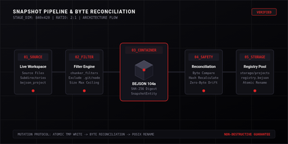

### 5.3 Byte-Perfect Project Restoration (`--restore`)

Restores an entire project hierarchy from its snapshot container using its `Versioned_UUID` or 8-character prefix.

```bash
# Syntax
python3 CLI/project_chunker.py --restore <selector> [--dest <dir>] [--overwrite]

# Examples
# 1. Restore to original archived location
python3 CLI/project_chunker.py --restore 41788b6d

# 2. Restore to an alternate directory
python3 CLI/project_chunker.py --restore 41788b6d --dest /tmp/restored_project

# 3. Restore with overwrite authorization for existing files
python3 CLI/project_chunker.py --restore 41788b6d --dest /tmp/restored_project --overwrite

# 4. Write live tracker file (bejson_project.json) during restore
python3 CLI/project_chunker.py --restore 41788b6d --write-tracker
```

### 5.4 Project Type & Status Combobox Filtering

Both web applications and the CLI provide multi-axis filtering across project types and lifecycle states:

#### Supported Canonical Types:
- `python`: Standalone Python CLI tools, microservices, Flask/FastAPI backends.
- `bash`: Shell scripts, CLI utilities, wrapper scripts, Termux automations.
- `react`: React / Vite single-page applications and TSX component libraries.
- `website`: Static websites, documentation portals, editorial HTML documents.
- `angular`: Angular TypeScript applications.
- `app`: Mobile web applications, hybrid HTML5 games, interactive canvas tools.
- `library`: Core development libraries and utility modules.
- `skill`: Automation skills, extension routines, and daemon workers.

#### Supported Lifecycle Statuses:
- `tracked`: Workspace registered and tracked; snapshot not yet finalized.
- `chunked`: Snapshot created; source files retained in workspace.
- `archived`: Source files scooped; release stored exclusively in snapshot container.
- `restored`: Workspace reconstructed from snapshot storage onto disk.
- `Development` / `Active`: Actively maintained project.
- `Legacy` / `Inactive`: Deprecated or superseded project version.

```bash
# CLI Filtering Examples
# 1. List all projects matching type python
python3 CLI/project_chunker.py --list --filter-type python

# 2. List all projects matching status archived
python3 CLI/project_chunker.py --list --filter-status archived

# 3. Update status of a registered snapshot
python3 CLI/project_chunker.py --set-status Legacy 41788b6d

# 4. Update type of a registered snapshot
python3 CLI/project_chunker.py --set-type library 41788b6d
```

### 5.5 Dual Repository Collision Protection

To prevent accidental split-brain repository forks, `Project Chunker` tracks the `Official_Path` for every registered project:

```
[Target Path: /workspace/clone_b/ProjectA]
               │
               ▼
   [Query Master Registry]
               │
               ├── Official_Path == /workspace/clone_a/ProjectA
               │
               ▼
   [DUAL REPO WARNING TRIGGERED]
   Target '/workspace/clone_b/ProjectA' differs from official repo '/workspace/clone_a/ProjectA'.
   Proceed with caution: verify you are editing the canonical workspace.
```

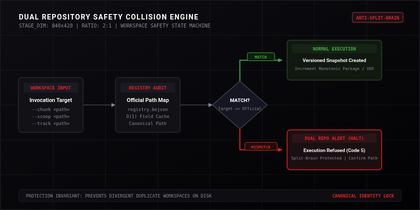

To update the official repository path to a new location:
```bash
python3 CLI/project_chunker.py --track /workspace/new_canonical_location
```

### 5.6 Explicit Version & Package Sequencing

`Project Chunker` preserves semantic version numbers and solid package integers:

```bash
# Override version attributes during chunking
python3 CLI/project_chunker.py --chunk ../my_app -V 2.0.0 -P 120

# Update version on existing registered snapshot
python3 CLI/project_chunker.py --set-version 2.0.1 41788b6d
python3 CLI/project_chunker.py --set-pkg 121 41788b6d
```

### 5.7 System Backups & Disaster Recovery (`--backup`)

Full system backups create self-contained ZIP archives containing the entire `storage/` hierarchy, master registry, tracker databases, snapshot containers, and configuration files.

```bash
# Create complete system backup ZIP
python3 CLI/project_chunker.py --backup

# List existing system backups with sizes and timestamps
python3 CLI/project_chunker.py --list-backups

# Restore storage state from a backup archive
python3 CLI/project_chunker.py --restore-backup storage/backups/prochunk_backup_20261106_021823Z.zip
```

### 5.8 Storage Schema In-Place Migration (`--migrate`)

When upgrading from earlier Project Chunker editions, the `--migrate` command automatically updates older registry formats:
- **Legacy 3-field registries** (`Versioned_UUID`, `Project_Name`, `Tracker_File`) are upgraded to 10-field records.
- Missing values are populated with deterministic defaults (`Project_Version=""`, `Status="tracked"`).
- Original registries are preserved with `.bak` extensions before in-place modification.

```bash
python3 CLI/project_chunker.py --migrate
```

### 5.9 Storage Pool Integrity Auditing (`--verify`)

The `--verify` audit sweeps the entire storage pool:
1. Re-computes SHA-256 hashes of all snapshot containers and verifies against stored values.
2. Checks that every `Snapshot_File` registered in `registry.bejson` exists on disk.
3. Validates bidirectional linking between `registry.bejson` and individual tracker databases.
4. Identifies orphan snapshot containers not referenced in the master index.

```bash
# Verify entire storage pool
python3 CLI/project_chunker.py --verify

# Verify a single project by name
python3 CLI/project_chunker.py --verify-project MyProject
```

### 5.10 Exclusion & Inclusion Filter Switches

Configured in `config/chunker_filters.json`, filters omit non-essential assets from snapshots:

```bash
# List all configured filter rules and their enabled status
python3 CLI/project_chunker.py --list-filters

# Disable all filters and capture raw directory contents including .git
python3 CLI/project_chunker.py --chunk ../project --no-filters

# Exclude an additional directory on an ad-hoc basis
python3 CLI/project_chunker.py --chunk ../project --exclude build --exclude dist

# Add extra file extension exclusions
python3 CLI/project_chunker.py --chunk ../project --ext .log --ext .bak
```

### 5.11 Snapshot Replacement Conflict Strategies

When chunking a project version whose `Versioned_UUID` or `(Project_Version, Package_Version)` already exists:
- `--on-conflict backup` (Default): Moves the existing snapshot to `storage/superseded/<Project>/` before saving the new container.
- `--on-conflict refuse`: Halts execution and preserves the existing snapshot without modification.

```bash
python3 CLI/project_chunker.py --chunk ../my_project --on-conflict backup
```

---

## 6. Visual Interface Tour

The unified web workstation provides visual interfaces for all chunker capabilities:

### 6.1 Unified Dashboard

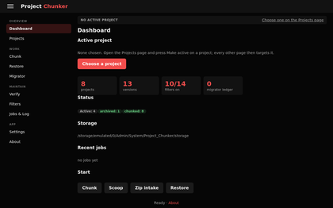
*_Figure 1: Unified Dashboard displaying system health, project counters, and storage utilization_*

The dashboard summarizes total registered projects, total version packages, total storage consumed, and recent execution events. Quick action buttons allow one-click navigation to primary workflows.

### 6.2 Projects Registry & Combobox Filters

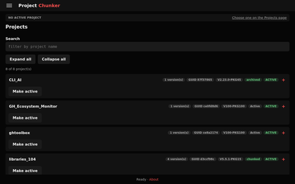
*_Figure 2: Multi-Version Projects Registry with search, type combobox, and status combobox filters_*

The Projects view displays all tracked releases with instant client-side combobox filters for `Type` and `Status`, collapsible version cards, and action buttons for file inspection, zip export, and restoration.

### 6.3 Chunk, Track & Scoop Console

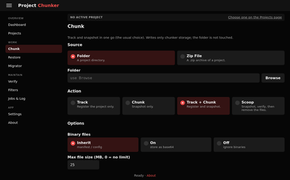
*_Figure 3: Chunk, Track, Scoop, and Archive Studio with configurable options_*

The unified Chunk console handles interactive directory tracking, snapshotting, and atomic scoop operations with live path validation and directory browsing modals.

### 6.4 Snapshot Restoration Console

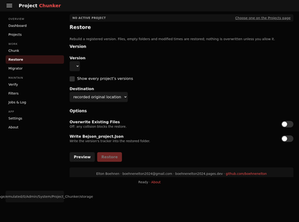
*_Figure 4: Snapshot Inspection and Restoration Console with destination overrides_*

Restores releases back to their original workspace coordinates or extracts them into custom staging folders with overwrite protection and dry-run previews.

### 6.5 Storage Schema Migrator

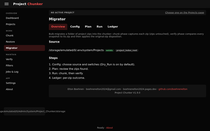
*_Figure 5: In-Place Storage Schema Migrator upgrading registries losslessly_*

The Migrator detects legacy registries and performs atomic, lossless migrations to the latest 10-field schema with backup protection.

### 6.6 Storage Integrity Verifier

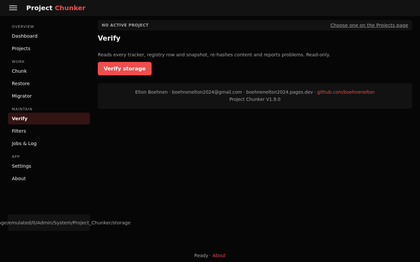
*_Figure 6: SHA-256 Storage Integrity Auditor checking files against registries_*

The Verifier sweeps storage pools, comparing physical snapshot files against master registry indexes and validating internal JSON document structures.

### 6.7 Filter Configuration Switches

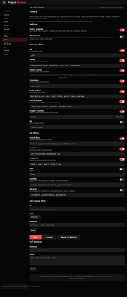
*_Figure 7: Directory & File Exclusion Switches managing chunker filter rules_*

Configure granular inclusion and exclusion rules (e.g., toggling `.git/`, `__pycache__/`, `node_modules/`, and large binary thresholds).

### 6.8 Background Jobs & Telemetry Log

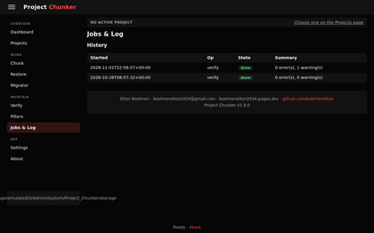
*_Figure 8: Background Job Execution & Process Telemetry Logs_*

Inspect active and historical background jobs, standard output streams, process lifecycle states, and execution timings in real time.

### 6.9 Application Settings & Storage Paths

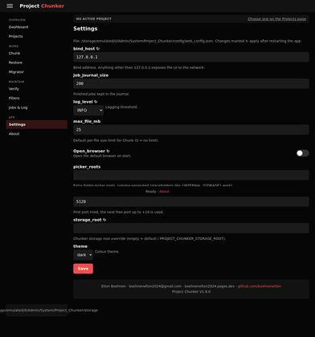
*_Figure 9: Host Binding, Theme, and Storage Preferences Console_*

Configure server bind addresses, default port ranges, visual themes (Dark / Light), and local filesystem root boundaries.

### 6.10 System Specification & About View

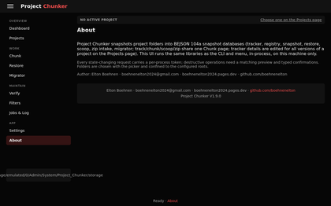
*_Figure 10: Technical Specifications & Maintenance Credit Console_*

Technical metadata overview detailing library dependencies, schema versions, and ecosystem runtime standards.

---

## 7. System Architecture & Subsystem Layout

### 7.1 6-Tier Directory Tree

```
Project_Chunker/
├── CLI/
│   └── project_chunker.py          # Unified CLI entry point & argument parser
├── Menu/
│   └── project_chunker_menu.py     # 57-column interactive terminal menu
├── Web/
│   ├── project_chunker_flask.py    # Primary Flask server launcher & port selector
│   ├── project_management_flask.py # Standalone read-only project viewer
│   ├── chunker_web/                # Modular Flask blueprints & API handlers
│   │   ├── __init__.py             # Package initialization & blueprint exports
│   │   ├── core.py                 # Application context & configuration loader
│   │   ├── pages.py                # Page routes & navigation layout definitions
│   │   ├── api_data.py             # Data query endpoints (projects, stats, filters)
│   │   ├── api_work.py             # Execution endpoints (chunk, scoop, restore)
│   │   ├── active.py               # Active workspace selection & path resolution
│   │   ├── jobs.py                 # Background process worker & state machine
│   │   └── picker.py               # Local filesystem browsing helper
│   ├── templates/                  # Jinja2 layout templates
│   │   ├── base.html               # Shared base template with navigation shell
│   │   └── chunker/                # Unified workstation sub-templates
│   │       ├── dashboard.html      # Overview metrics & quick actions
│   │       ├── projects.html       # Projects registry with filter controls
│   │       ├── chunk.html          # Chunk/scoop workflow interface
│   │       ├── restore.html        # Restoration interface
│   │       ├── migrator.html       # Migration management interface
│   │       ├── verify.html         # Integrity verifier interface
│   │       ├── filters.html        # Filter switch toggles
│   │       ├── jobs.html           # Background job telemetry viewer
│   │       ├── settings.html       # Host, port & theme preferences
│   │       └── about.html          # Technical specs & credits
│   └── static/                     # Web assets
│       ├── chunker/chunker.js      # Client-side SPA interaction & filter logic
│       └── becss/                  # High-contrast stylesheet tokens
├── lib/
│   ├── lib_bejson_Core_bejson_core.py      # Low-level BEJSON parsing & atomic I/O
│   ├── lib_bejson_Core_bejson_validator.py # Document structural validator
│   ├── lib_bejson_Projects_tracker.py      # Tracker detection, creation, & identity
│   ├── lib_bejson_Projects_registry.py     # Master registry CRUD & schema migrations
│   ├── lib_bejson_Projects_snapshot.py     # Directory walking & snapshot compilation
│   ├── lib_bejson_Projects_pipeline.py     # End-to-end orchestration pipeline
│   ├── lib_bejson_Projects_view.py         # Read-only view model with type & status
│   ├── lib_bejson_Projects_filters.py      # Path pattern & extension filters
│   ├── lib_bejson_Projects_paths.py        # Storage layout & path resolution
│   ├── lib_bejson_Projects_locks.py        # Process-level concurrency locks
│   ├── lib_bejson_Projects_backup.py       # System backup creation & verification
│   └── lib_bejson_Projects_logging.py      # Structured logging adapter
├── config/
│   ├── chunker_filters.json        # Exclusion & inclusion switch definitions
│   └── web_config.json             # Web application host and port defaults
├── data/
│   ├── active_project.json         # UI state tracking active project selection
│   └── web_jobs.bejson             # Telemetry log of executed web operations
├── storage/
│   ├── master/data/registry.bejson # Central master registry tracking all releases
│   ├── project_snapshots/          # Partitioned project snapshots (<Project>/data/)
│   ├── trackers/data/              # Isolated project tracker databases
│   ├── backups/                    # Automated system backups
│   └── superseded/                 # Previous snapshots replaced during conflicts
└── dev/
    └── tests/                      # Conformance, backup & Playwright test suites
```

### 7.2 Storage Pool Organization & Partitioning

The storage pool separates concerns into four distinct directories:
1. `storage/master/data/registry.bejson`: Master catalog tracking all project releases, versions, original locations, and types.
2. `storage/trackers/data/<project>.bejson`: Project-specific tracker history table storing successive revisions of `bejson_project.json`.
3. `storage/project_snapshots/<Project>/data/<UUID>.bejson`: Snapshot container holding every file and empty directory.
4. `storage/superseded/<Project>/data/<UUID>_<timestamp>.bejson`: Archive partition holding displaced snapshots when replacement occurs under `--on-conflict backup`.

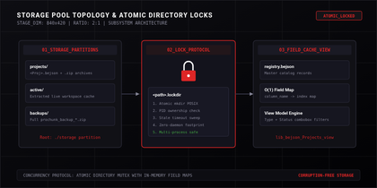

### 7.3 Process Concurrency & Atomic Lock Protocols

To ensure multi-process integrity when CLI tools, background workers, and web requests access the same repository simultaneously:
- **Lock Implementation**: Managed via `lib_bejson_Projects_locks.py` using directory-based POSIX locks (`<target>.lockdir`). Directory creation is an atomic operating system primitive on POSIX filesystems.
- **Stale Lock Recovery**: Locks record the owning PID and timestamp. If a process holding a lock terminates abnormally, subsequent processes inspect the PID; if the PID is deceased, the lock is cleared automatically after a configurable timeout (default 30 seconds).

### 7.4 View Model & Cache Architecture

`lib_bejson_Projects_view.py` provides an in-memory cached view model aggregating registry records with snapshot header facts:
- **Snapshot Facts Cache**: Caches file counts, byte sizes, and snapshot dates keyed by `(path, mtime_ns, size)`. Avoids re-parsing multi-megabyte snapshot files on repeated directory queries.
- **Cache Eviction**: Automatic FIFO eviction when cached entries exceed 512 objects.

---

## 8. BEJSON Tabular Schemas & Data Specifications

### 8.1 Snapshot Entity Schema (`SnapshotEntity` v2.1)

Maintained in `storage/project_snapshots/<Project>/data/<UUID>.bejson`.

```json
{
  "Format": "BEJSON",
  "Format_Version": "104a",
  "Format_Creator": "Elton Boehnen",
  "Records_Type": ["SnapshotEntity"],
  "Snapshot_Version": "2.1",
  "Snapshot_Date": "2026-11-06T02:08:00Z",
  "Project_Name": "MyProject",
  "Versioned_UUID": "41788b6d-644f-4beb-a982-048fe6937a4d",
  "Binary_Enabled": true,
  "Fields": [
    {"name": "File_Name", "type": "string"},
    {"name": "File_Extension", "type": "string"},
    {"name": "Relative_Path", "type": "string"},
    {"name": "File_Content", "type": "string"},
    {"name": "Base64", "type": "string"},
    {"name": "File_Hash", "type": "string"},
    {"name": "Flags", "type": "string"},
    {"name": "Is_Mounted", "type": "boolean"},
    {"name": "Modified_Time", "type": "string"},
    {"name": "Is_Empty_Dir", "type": "boolean"}
  ],
  "Values": [
    [
      "main.py",
      ".py",
      "src/main.py",
      "print('hello')
",
      "",
      "e3b0c44298fc1c149afbf4c8996fb92427ae41e4649b934ca495991b7852b855",
      "[]",
      false,
      "2026-11-06T02:00:00.000000Z",
      false
    ]
  ]
}
```

### 8.2 Master Registry Schema (`RegistryRecord` v3)

Maintained in `storage/master/data/registry.bejson`.

```json
{
  "Format": "BEJSON",
  "Format_Version": "104a",
  "Format_Creator": "Elton Boehnen",
  "Records_Type": ["RegistryRecord"],
  "Fields": [
    {"name": "Versioned_UUID", "type": "string"},
    {"name": "Project_Name", "type": "string"},
    {"name": "Tracker_File", "type": "string"},
    {"name": "Project_Version", "type": "string"},
    {"name": "Package_Version", "type": "string"},
    {"name": "Original_Path", "type": "string"},
    {"name": "Snapshot_File", "type": "string"},
    {"name": "Status", "type": "string"},
    {"name": "Updated_At", "type": "string"},
    {"name": "Type", "type": "string"},
    {"name": "Official_Path", "type": "string"}
  ],
  "Values": [
    [
      "41788b6d-644f-4beb-a982-048fe6937a4d",
      "Project_Chunker",
      "storage/trackers/data/Project_Chunker.bejson",
      "1.9.0",
      "115",
      "/path/to/canonical/Project_Chunker",
      "storage/project_snapshots/Project_Chunker/data/41788b6d-644f-4beb-a982-048fe6937a4d.bejson",
      "Development",
      "2026-11-06T02:08:00Z",
      "python",
      "/path/to/canonical/Project_Chunker"
    ]
  ]
}
```

### 8.3 Project Tracker Schema (`TrackerRecord` v1)

Maintained in `storage/trackers/data/<project>.bejson`.

| Column Index | Field Name | Type | Description |
|:---:|:---|:---:|:---|
| 0 | `Versioned_UUID` | string | Release snapshot UUIDv4 identifier |
| 1 | `Project_Name` | string | Canonical project name matching tracker manifest |
| 2 | `Tracker_Data` | string | Stringified JSON document mirroring `bejson_project.json` |

### 8.4 Web Jobs Telemetry Schema (`WebJobRecord` v1)

Maintained in `data/web_jobs.bejson`.

| Column Index | Field Name | Type | Description |
|:---:|:---|:---:|:---|
| 0 | `Job_ID` | string | Unique alphanumeric job identifier |
| 1 | `Operation` | string | Operation name (`chunk`, `scoop`, `restore`, `verify`, `tracker_edit`) |
| 2 | `State` | string | Current state: `running`, `done`, `failed`, `cancelled` |
| 3 | `Target` | string | Target directory or project selector |
| 4 | `Started_At` | string | ISO-8601 UTC start timestamp |
| 5 | `Finished_At` | string | ISO-8601 UTC completion timestamp |
| 6 | `Error_Message` | string | Detailed error string if job failed |

### 8.5 Project Manifest Format (`bejson_project.json`)

Standard project identity tracker placed in the root of managed codebases:

```json
{
  "Format": "BEJSON",
  "Format_Version": "104a",
  "Format_Creator": "Elton Boehnen",
  "Project_Name": "MyTool",
  "Project_Version": "1.0.0",
  "Package_Version": "100",
  "Project_GUID": "GUID_PLACEHOLDER",
  "Versioned_UUID": "41788b6d-644f-4beb-a982-048fe6937a4d",
  "Status": "Active",
  "Type": "python",
  "Archive_Filename": "MyTool-V100-PKG100.zip",
  "Project_Modified_Date": "2026-11-06T02:00:00Z",
  "Description": "High-performance CLI tool.",
  "Author": "Elton Boehnen"
}
```

### 8.6 Filter Configuration Format (`chunker_filters.json`)

Stored in `config/chunker_filters.json`:

```json
{
  "filters": [
    {"id": "git", "name": "Git Repository Metadata", "pattern": ".git", "type": "dir", "enabled": true},
    {"id": "pycache", "name": "Python Bytecode Cache", "pattern": "__pycache__", "type": "dir", "enabled": true},
    {"id": "node_modules", "name": "Node Modules Dependencies", "pattern": "node_modules", "type": "dir", "enabled": true},
    {"id": "pyc", "name": "Python Compiled Files", "pattern": "*.pyc", "type": "file", "enabled": true},
    {"id": "pytest", "name": "Pytest Cache", "pattern": ".pytest_cache", "type": "dir", "enabled": true}
  ]
}
```

### 8.7 Web Server Configuration Format (`web_config.json`)

Stored in `config/web_config.json`:

```json
{
  "host": "127.0.0.1",
  "port_range_start": 5140,
  "port_range_end": 5170,
  "theme": "dark",
  "log_level": "INFO",
  "max_upload_mb": 250
}
```

---

## 9. Internal Library API Reference

### 9.1 `lib_bejson_Core_bejson_core.py`
Provides low-level BEJSON parsing, atomic file writing, and field map generation.

```python
def bejson_core_load_file(file_path: Path) -> Dict[str, Any]:
    '''Parse and load a BEJSON file into a dictionary with verified structure.'''

def bejson_core_atomic_write(file_path: Path, data: Dict[str, Any]) -> None:
    '''Serialize dictionary to JSON and atomically write to disk using temp file rename.'''

def bejson_core_get_field_map(doc: Dict[str, Any]) -> Dict[str, int]:
    '''Return O(1) field name to column index mapping from document Fields definition.'''
```

### 9.2 `lib_bejson_Core_bejson_validator.py`
Validates BEJSON tabular structural integrity and schema conformity.

```python
def validate_bejson(doc: Dict[str, Any]) -> Tuple[bool, List[str]]:
    '''Validate BEJSON header fields, types, and tabular dimensions against specification.
    Returns (is_valid, list_of_error_strings).'''
```

### 9.3 `lib_bejson_Projects_paths.py`
Resolves storage layouts, sanitize project names, and manages path boundaries.

```python
class StorageLayout:
    storage_root: Path
    master_dir: Path
    trackers_dir: Path
    snapshots_dir: Path
    backups_dir: Path
    superseded_dir: Path

def projects_paths_resolve_storage_layout(project_root: Path, storage_root: Optional[Path] = None) -> StorageLayout:
    '''Resolve and create standardized StorageLayout directory structure.'''

def projects_paths_sanitize_name(name: str) -> str:
    '''Sanitize arbitrary string into safe POSIX file name (alphanumeric, underscore, dash).'''
```

### 9.4 `lib_bejson_Projects_tracker.py`
Detects, reads, and scaffolds project tracker documents.

```python
class TrackerInfo:
    project_name: str
    project_version: str
    package_version: str
    versioned_uuid: str
    project_guid: str
    project_type: str
    status: str
    tracker_path: Optional[Path]

def projects_tracker_detect_or_scaffold(target_dir: Path, fallback_name: str) -> TrackerInfo:
    '''Find existing bejson_project.json or generate in-memory tracker identity.'''
```

### 9.5 `lib_bejson_Projects_registry.py`
Manages master registry CRUD, queries, and schema migrations.

```python
def projects_registry_list(layout: StorageLayout, project_type: Optional[str] = None,
                           status: Optional[str] = None) -> List[Dict[str, Any]]:
    '''List all registered version records filtered optionally by type and status.'''

def projects_registry_get(layout: StorageLayout, selector: str) -> Dict[str, Any]:
    '''Retrieve unique record by Versioned_UUID or 8-char prefix.'''

def projects_registry_update(layout: StorageLayout, uuid_str: str, **fields) -> None:
    '''Update metadata fields (Status, Type, Version) on an existing registry row.'''

def projects_registry_get_official_path(layout: StorageLayout, project_name: str) -> Optional[str]:
    '''Retrieve the canonical repository path recorded for a project.'''
```

### 9.6 `lib_bejson_Projects_snapshot.py`
Handles workspace directory traversal, Base64 encoding, SHA-256 calculation, and snapshot packing.

```python
def projects_snapshot_create(target_dir: Path, output_file: Path, tracker_info: TrackerInfo,
                             filters_cfg: Optional[Dict[str, Any]] = None,
                             enable_binary: bool = True) -> Dict[str, Any]:
    '''Compile target directory into a verified BEJSON 104a snapshot container.
    Returns metadata summary dictionary (file count, byte sizes, empty dirs).'''

def projects_snapshot_load(snapshot_path: Path) -> Dict[str, Any]:
    '''Load and parse snapshot container from disk.'''

def projects_snapshot_reconcile(target_dir: Path, snapshot_doc: Dict[str, Any]) -> Tuple[bool, List[str]]:
    '''Compare live filesystem files against snapshot document byte-for-byte.
    Returns (matches_perfectly, list_of_discrepancies).'''
```

### 9.7 `lib_bejson_Projects_pipeline.py`
High-level orchestrator executing compound chunk, scoop, and restore workflows.

```python
def projects_pipeline_chunk(layout: StorageLayout, target_dir: Path, track: bool = True,
                            dry_run: bool = False, **overrides) -> PipelineResult:
    '''Execute complete snapshot pipeline for target directory.'''

def projects_pipeline_scoop(layout: StorageLayout, target_dir: Path, delete_filtered: bool = False,
                            **overrides) -> PipelineResult:
    '''Execute chunk, verify byte reconciliation, and remove live source files.'''

def projects_pipeline_restore(layout: StorageLayout, selector: str, dest_dir: Optional[Path] = None,
                              overwrite: bool = False, write_tracker: bool = False) -> PipelineResult:
    '''Reconstruct workspace from snapshot container to target destination.'''
```

### 9.8 `lib_bejson_Projects_view.py`
Aggregates registry records with snapshot header facts into structured frontend view models.

```python
def projects_view_build(layout: StorageLayout) -> List[Dict[str, Any]]:
    '''Build project list sorted by name, grouping versions newest first,
    enriched with type, latest_type, Status, and snapshot metadata.'''
```

### 9.9 `lib_bejson_Projects_filters.py`
Evaluates path inclusion and exclusion against active filter switches.

```python
def projects_filters_should_exclude(rel_path: str, is_dir: bool,
                                    cfg: Dict[str, Any]) -> Tuple[bool, Optional[str]]:
    '''Determine if a file or directory should be excluded.
    Returns (should_exclude, matched_filter_name).'''
```

### 9.10 `lib_bejson_Projects_locks.py`
Manages process-level concurrency locks.

```python
class ProjectsPathLock:
    def __init__(self, lock_path: Path, timeout_seconds: float = 30.0): ...
    def __enter__(self): ...
    def __exit__(self, exc_type, exc_val, exc_tb): ...
```

### 9.11 `lib_bejson_Projects_backup.py`
Handles complete storage system backups and disaster recovery.

```python
def projects_backup_create(layout: StorageLayout, output_zip: Optional[Path] = None) -> Path:
    '''Package entire storage pool into an atomic, verified backup ZIP.'''

def projects_backup_restore(layout: StorageLayout, backup_zip: Path) -> None:
    '''Extract and restore storage pool state from a verified backup ZIP.'''
```

### 9.12 `lib_bejson_Projects_logging.py`
Standardized structured logging configuration.

```python
def projects_logging_configure(level: str = "INFO") -> None:
    '''Configure application-wide structured log format and output handlers.'''

def projects_logging_get_logger(name: str) -> logging.Logger:
    '''Return namespaced logger instance.'''
```

---

## 10. Command Line Interface (CLI) Complete Reference

### 10.1 Complete Options & Flag Matrix

```
usage: project_chunker [-h] [--track] [--chunk] [--scoop] [--delete-filtered]
                       [--confirm-delete-filtered] [--project-name NAME]
                       [--project-version VER] [--package-version PKG]
                       [--type TYPE] [--status STATUS] [--filter-type TYPE]
                       [--filter-status STATUS] [--set-status STATUS]
                       [--set-type TYPE] [--set-version VER] [--set-pkg PKG]
                       [--identity-from-filename]
                       [--on-conflict {backup,refuse}]
                       [--verify-project PROJECT] [--keep-zip]
                       [--restore UUID] [--dest DIR] [--overwrite]
                       [--write-tracker] [--versions PROJECT] [--list]
                       [--verify] [--dry-run] [--storage-root STORAGE_ROOT]
                       [--binary | --no-binary] [--exclude DIRNAME]
                       [--filters-config FILE] [--no-filters] [--filter ID]
                       [--no-filter ID] [--list-filters] [--ext .EXT]
                       [--max-file-mb MAX_FILE_MB]
                       [--log-level {DEBUG,INFO,WARNING,ERROR,CRITICAL}]
                       [--json] [--version]
                       [target]
```

| Flag | Parameter | Type | Default | Description |
|:---|:---|:---:|:---:|:---|
| `-h`, `--help` | None | Flag | `False` | Display complete CLI usage and exit |
| `--chunk` | `TARGET` | Path | None | Snapshot directory into BEJSON 104a container |
| `--scoop` | `TARGET` | Path | None | Snapshot, verify byte reconciliation, and remove source |
| `--track` | `TARGET` | Path | None | Scaffold tracker and register repository path |
| `--restore` | `UUID` | String | None | Restore project from snapshot selector |
| `--dest` | `DIR` | Path | Recorded path | Custom destination directory for `--restore` |
| `--overwrite` | None | Flag | `False` | Authorize overwriting existing files on restore |
| `--write-tracker`| None | Flag | `False` | Write `bejson_project.json` to root during restore |
| `--list` | None | Flag | `False` | Display tabular registry of all projects |
| `--versions` | `NAME` | String | None | Display version history for specific project |
| `--verify` | None | Flag | `False` | Audit all snapshots and registry integrity |
| `--verify-project`| `NAME` | String | None | Audit snapshots for single named project |
| `--type` | `TYPE` | String | Auto | Override project type (checked against ledger) |
| `--status` | `STATUS` | String | `Active` | Override project lifecycle status |
| `--filter-type` | `TYPE` | String | None | Filter `--list` output by canonical project type |
| `--filter-status`| `STATUS` | String | None | Filter `--list` output by lifecycle status |
| `--set-type` | `TYPE` | String | None | Update project type for registered UUID |
| `--set-status` | `STATUS` | String | None | Update lifecycle status for registered UUID |
| `-V`, `--project-version`| `VER` | String | From tracker | Override `Project_Version` string |
| `-P`, `--package-version`| `PKG` | String | From tracker | Override `Package_Version` integer |
| `--on-conflict` | `ACTION` | Choice | `backup` | Strategy on collision: `backup` or `refuse` |
| `--dry-run` | None | Flag | `False` | Preview operations without modifying disk |
| `--no-filters` | None | Flag | `False` | Disable all inclusion/exclusion filter rules |
| `--exclude` | `DIR` | String | None | Add directory exclusion pattern (repeatable) |
| `--ext` | `.EXT` | String | None | Add file extension exclusion pattern (repeatable) |
| `--backup` | None | Flag | `False` | Create full storage system backup archive |
| `--list-backups` | None | Flag | `False` | List all historical system backup archives |
| `--restore-backup`| `ZIP` | Path | None | Restore system storage from backup archive |
| `--storage-root`| `PATH` | Path | `./storage` | Custom storage root directory override |
| `--json` | None | Flag | `False` | Output results in structured JSON format |
| `--log-level` | `LEVEL` | Choice | `INFO` | Logging level (`DEBUG`, `INFO`, `WARNING`, `ERROR`) |

### 10.2 Return & Exit Codes

| Exit Code | Meaning | Remediation |
|:---:|:---|:---|
| `0` | Success | Operation completed normally. |
| `1` | General Runtime Error | Inspect error message or check system permissions. |
| `2` | Argument Parsing Error | Check CLI flag syntax and parameter types. |
| `3` | Lock Collision | Another process is accessing storage. Wait or remove stale lock. |
| `4` | Byte Reconciliation Mismatch | File modified during scoop. Verify files and retry. |
| `5` | Dual Repo Collision Refusal | Target does not match registered official path. Confirm canonical path. |

### 10.3 Scripting & Shell Pipeline Recipes

```bash
# Recipe 1: Headless CI Snapshot with JSON verification
python3 CLI/project_chunker.py --chunk ./build_output -V "1.0.0" -P 101 --type python --json > chunk_summary.json

# Recipe 2: Automated Sweep of Finished Feature Branches
for branch_dir in ./work/feature_*; do
  if [ -d "$branch_dir" ]; then
    python3 CLI/project_chunker.py --scoop "$branch_dir" --type python
  fi
done

# Recipe 3: Nightly Integrity Audit Cron Job
0 3 * * * cd "${PROJECT_ROOT:-$PWD}" && python3 CLI/project_chunker.py --verify >> ./logs/chunker_audit.log 2>&1
```

---

## 11. Web Workstations & REST API Reference

### 11.1 Server Discovery & Dynamic Port Allocation

The launcher (`Web/project_chunker_flask.py`) tests port availability starting at 5140 up to 5170. If port 5140 is bound by another service, the launcher automatically selects the next sequential free port.

```bash
# Launch on default port range
python3 Web/project_chunker_flask.py

# Launch binding to specific port
python3 Web/project_chunker_flask.py --port 5200

# Launch binding to all network interfaces
python3 Web/project_chunker_flask.py --host 0.0.0.0 --port 5140
```

### 11.2 Security & CSRF Token Architecture

- **Session Security Token**: Every server session generates an ephemeral 32-character hexadecimal token rendered in `<meta name="chunker-token">`.
- **State-Changing Protection**: All mutation endpoints (`POST /api/run/*`, `POST /api/active`, `POST /api/filters`) require the token via the `X-Chunker-Token` HTTP header, preventing cross-site request forgery.
- **Host Header Validation**: Requests with mismatched or malicious `Host` headers are rejected with `403 Forbidden`.
- **Directory Traversal Protection**: Export and download endpoints reject path sequences containing `..` or leading slashes.

### 11.3 Complete REST API Endpoints Specification

| Endpoint | Method | Purpose | Request Body / Parameters | Response Schema |
|:---|:---:|:---|:---|:---|
| `/api/meta` | `GET` | System version and storage paths | None | `{"ok": true, "version": str, "storage_root": str}` |
| `/api/projects` | `GET` | List projects with types and statuses | `?type=<str>&status=<str>` | `{"ok": true, "projects": [...], "types": [...], "statuses": [...]}` |
| `/api/projects/<name>/tracker` | `GET` | Project tracker editable fields | None | `{"ok": true, "editable": [...], "extras": [...]}` |
| `/api/preview/tracker` | `POST` | Preview tracker field edits | `{"name": str, "changes": dict}` | `{"ok": true, "plan_id": str, "result": dict}` |
| `/api/run/tracker` | `POST` | Apply tracker edits to storage | `{"name": str, "plan_id": str, "confirm": true}` | `{"ok": true, "job_id": str}` |
| `/api/projects/<uuid>/files` | `GET` | List snapshot file hierarchy | `?q=<search_str>` | `{"ok": true, "rows": [...], "total": int}` |
| `/api/projects/<uuid>/file` | `GET` | Retrieve single file content | `?path=<relative_path>` | `{"ok": true, "path": str, "text": str, "size": int}` |
| `/api/projects/<uuid>/export` | `POST` | Build downloadable release ZIP | None | `{"ok": true, "name": str, "size": int}` |
| `/api/download/<name>` | `GET` | Download compiled release ZIP | None | Binary ZIP stream (`attachment`) |
| `/api/preview/chunk` | `POST` | Validate target path for chunking | `{"target": str, "track": bool}` | `{"ok": true, "plan_id": str, "result": dict}` |
| `/api/run/chunk` | `POST` | Execute chunking job | `{"target": str, "plan_id": str}` | `{"ok": true, "job_id": str}` |
| `/api/preview/scoop` | `POST` | Validate files for scoop archival | `{"target": str, "delete_filtered": bool}` | `{"ok": true, "plan_id": str, "result": dict}` |
| `/api/run/scoop` | `POST` | Execute scoop and wipe job | `{"target": str, "plan_id": str, "confirm": true}` | `{"ok": true, "job_id": str}` |
| `/api/preview/restore` | `POST` | Check target destination | `{"selector": str, "dest": str}` | `{"ok": true, "plan_id": str, "result": dict}` |
| `/api/run/restore` | `POST` | Execute restoration job | `{"selector": str, "dest": str, "overwrite": bool}` | `{"ok": true, "job_id": str}` |
| `/api/filters` | `GET` | Read active filter switches | None | `{"ok": true, "rows": [...], "file": str}` |
| `/api/filters` | `POST` | Save updated filter switches | `{"rows": [...]}` | `{"ok": true, "saved": int}` |
| `/api/jobs` | `GET` | Read all recent background jobs | None | `{"ok": true, "jobs": [...], "current": dict}` |
| `/api/jobs/<job_id>` | `GET` | Poll specific background job status | None | `{"ok": true, "job": {"state": str, ...}}` |
| `/api/active` | `GET` | Get currently active project | None | `{"ok": true, "active": str}` |
| `/api/active` | `POST` | Set active project by name | `{"name": str}` | `{"ok": true, "active": str}` |
| `/api/active` | `DELETE` | Clear active project selection | None | `{"ok": true, "active": null}` |
| `/api/picker` | `GET` | Browse local filesystem directories | `?path=<dir>&files=1` | `{"ok": true, "path": str, "dirs": [...], "files": [...]}` |

### 11.4 cURL Workflow Examples & Payload Contracts

#### Example 1: Query Projects with Type and Status Filters
```bash
curl -s "http://127.0.0.1:5140/api/projects?type=python&status=Development" | jq .
```

Response payload:
```json
{
  "ok": true,
  "projects": [
    {
      "name": "Project_Chunker",
      "version_count": 1,
      "latest_status": "Development",
      "type": "python",
      "latest_type": "python",
      "versions": [
        {
          "Versioned_UUID": "41788b6d-644f-4beb-a982-048fe6937a4d",
          "Project_Name": "Project_Chunker",
          "Project_Version": "1.9.0",
          "Package_Version": "115",
          "Status": "Development",
          "Type": "python",
          "Version_Label": "V1.9.0-PKG115",
          "files": 54,
          "snapshot_bytes": 1054200,
          "snapshot_state": "ok"
        }
      ]
    }
  ],
  "types": ["app", "bash", "library", "python", "react", "skill", "website"],
  "statuses": ["Active", "Development", "Legacy", "archived", "chunked", "tracked"]
}
```

#### Example 2: Triggering an Asynchronous Snapshot Chunk
```bash
# Step 1: Preview target path
PREVIEW=$(curl -s -X POST http://127.0.0.1:5140/api/preview/chunk   -H "Content-Type: application/json"   -H "X-Chunker-Token: $TOKEN"   -d '{"target": "/path/to/my_tool", "track": true}')
PLAN_ID=$(echo $PREVIEW | jq -r .plan_id)

# Step 2: Execute chunking job
JOB=$(curl -s -X POST http://127.0.0.1:5140/api/run/chunk   -H "Content-Type: application/json"   -H "X-Chunker-Token: $TOKEN"   -d "{"target": "/path/to/my_tool", "plan_id": "$PLAN_ID"}")
JOB_ID=$(echo $JOB | jq -r .job_id)

# Step 3: Poll job until completed
curl -s "http://127.0.0.1:5140/api/jobs/$JOB_ID" | jq .job.state
```

---

## 12. Antigravity System Integration

### 12.1 Lifecycle Hook Handler (`project_chunker_hook.py`)

Located in `.agents/hooks/project_chunker_hook.py`, this script integrates with the Antigravity CLI lifecycle hook pipeline:
- **Hook Protocol**: Communicates via standard input/output using camelCase JSON messages.
- **Invocation Event**: Triggers on `PostInvocation`.
- **Integrity Validation**: Runs a lightweight audit verifying that all modified project workspaces have updated snapshot containers.
- **Log Emission**: Emits structured diagnostics to standard error and completion events to `$GLOBAL_LOGS/Log-<YYYY-MM-DD>.bejson`.

### 12.2 Declarative Subagent (`project-chunk-manager.md`)

Located in `.agents/agents/project-chunk-manager.md`, this agent definition equips autonomous subagents to manage background project archival:
- **Role**: Project Chunk & Workspace Hygiene Manager.
- **Capabilities**: Validates project structures, identifies completed feature directories, executes atomic `--scoop` commands, and reconciles storage pools without human intervention.

---

## 13. Testing, Conformance & Verification Suites

### 13.1 Conformance & Unit Test Suite (`test_project_chunker.py`)

A comprehensive test suite exercising all core libraries, CLI arguments, error conditions, and web endpoints.

```bash
# Run entire unit test suite
python3 dev/tests/test_project_chunker.py

# Run specific test classes
python3 -m unittest dev/tests/test_project_chunker.py -k TestProjectManagementWeb
python3 -m unittest dev/tests/test_project_chunker.py -k TestWebApp
python3 -m unittest dev/tests/test_project_chunker.py -k TestPolicyLint
```

Expected test result:
```
Ran 258 tests in ~80s
OK (skipped=1)
```

#### Coverage Highlights:
- **BEJSON Parsing & Validation**: Tests atomic writes, corrupted JSON recovery, and schema checking.
- **Snapshot Creation & Reconciliation**: Tests UTF-8 files, binary byte sequences, empty folders, and byte tampering detection.
- **Master Registry CRUD**: Tests row insertion, deduplication, schema migration (3-field to 10-field), and version sorting.
- **Concurrency & Locking**: Tests multi-threaded lock contention and stale lock recovery.
- **Web APIs & Filtering**: Tests security tokens, host gates, project querying, and Type/Status combobox filtering.

### 13.2 System Backup Integrity Test Suite (`test_project_backup.py`)

Exercises system-wide backup creation, verification, and restoration:

```bash
python3 dev/tests/test_project_backup.py
```

Expected test result:
```
Ran 4 tests in ~15s
OK
```

### 13.3 Playwright End-to-End Browser Test Suite (`test_project_chunker_playwright.py`)

Executes automated Chromium browser testing across all 10 unified workstation pages and captures fresh 420p screenshots:

```bash
python3 dev/tests/test_project_chunker_playwright.py
```

Expected test scorecard:
```
--------------------------------------------------------------
Screenshot File                  Page Label       Status   Time
--------------------------------------------------------------
01_dashboard.png                 Dashboard        PASS     ~1800 ms
02_projects.png                  Projects         PASS     ~1700 ms
03_chunk.png                     Chunk            PASS     ~2900 ms
04_restore.png                   Restore          PASS     ~1600 ms
05_migrator.png                  Migrator         PASS     ~1650 ms
06_verify.png                    Verify           PASS     ~1150 ms
07_filters.png                   Filters          PASS     ~2000 ms
08_jobs.png                      Jobs & Log       PASS     ~1250 ms
09_settings.png                  Settings         PASS     ~1550 ms
10_about.png                     About            PASS     ~1050 ms
--------------------------------------------------------------
Total: 10/10 captured. Result: PASS
```

---

## 14. Troubleshooting & Diagnostic Reference

### 14.1 Diagnostic Failure Matrix

| Symptom / Error | Root Cause | Remediation Procedure |
|:---|:---|:---|
| `DUAL REPO ALERT` | Target path differs from registered `Official_Path` | Confirm target is canonical. If relocating project permanently, update with `--track <new_path>`. |
| `Lock collision: storage locked by PID <PID>` | Previous process aborted abruptly leaving lock directory | Verify if PID is running via `ps -p <PID>`. If deceased, wait 30 seconds for auto-clear or remove `storage/*.lockdir`. |
| `Byte reconciliation mismatch during scoop` | File altered or generated during snapshot compilation | Check workspace for background file writers (e.g., active compilers or file watchers). Re-run `--scoop`. |
| `Snapshot unreadable: JSONDecodeError` | Corrupted snapshot file caused by hardware interruption | Check `storage/superseded/` for previous snapshot versions or restore from latest system backup (`--restore-backup`). |
| `403 Forbidden on API request` | Missing or invalid `X-Chunker-Token` header | Obtain current token from `<meta name="chunker-token">` or restart server. |
| `Port 5140 in use` | Another instance of Project Chunker or Flask is running | Launcher auto-selects next free port (5141+). Check console startup log for active URL. |

### 14.2 Corrupt Snapshot Recovery Protocols

If a snapshot container becomes corrupted due to hardware or storage failure:
1. Identify the corrupt file path using `python3 CLI/project_chunker.py --verify`.
2. Inspect `storage/superseded/<Project>/` to check if a prior version of the snapshot exists.
3. If superseded snapshot exists, copy it back into `storage/project_snapshots/<Project>/data/<UUID>.bejson`.
4. If no superseded snapshot exists, restore storage pool from system backup using `python3 CLI/project_chunker.py --restore-backup <backup.zip>`.

---

## 15. Maintenance & Credits

`Project Chunker` is maintained under continuous verification.

- **Author & Maintainer**: Elton Boehnen
- **Email**: boehnenelton2024@gmail.com
- **Website**: [boehnenelton2024.pages.dev](https://boehnenelton2024.pages.dev)
- **GitHub**: [github.com/boehnenelton](https://github.com/boehnenelton)
- **Repository**: [github.com/boehnenelton/Project_Chunker](https://github.com/boehnenelton/Project_Chunker)
- **Format Standard**: BEJSON 104a
- **Runtime Standard**: Python 3.10+
- **Release Version**: `1.9.0`
- **Package Version**: `115`
- **License**: MIT
