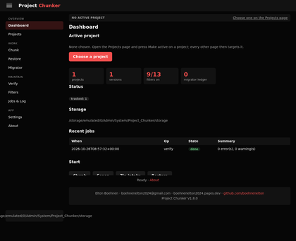
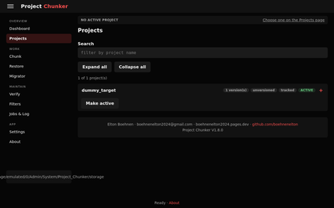
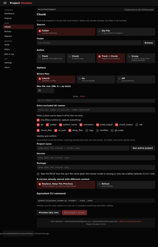
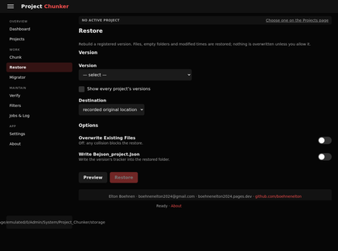
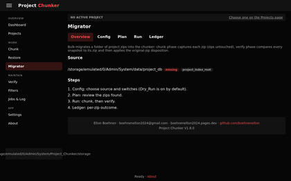
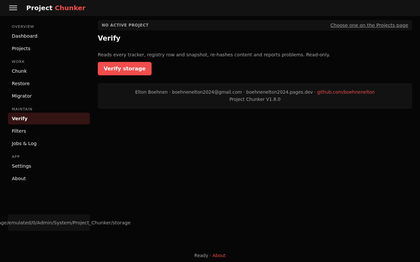
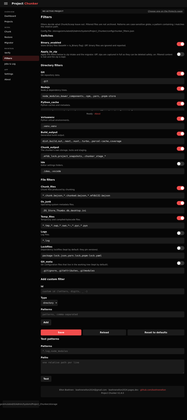
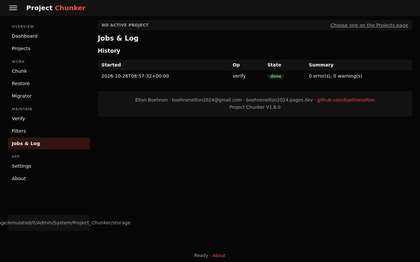
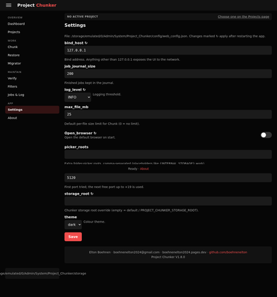
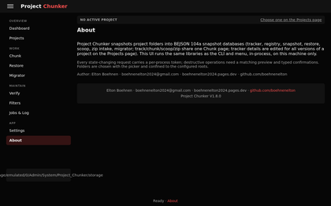

# Project Chunker

High-density project snapshotting, atomic archive-and-scoop (`--scoop`), multi-version registry tracking, and zero-SQL web workstation for Linux and Termux environments.

`Project Chunker` provides an end-to-end framework for capturing full repository state into portable, deterministic BEJSON 104a snapshot containers. It eliminates unmanaged filesystem drift through single-file containerization, verified SHA-256 byte reconciliation, automated packaging versioning, and an integrated local web workstation.

---

## Table of Contents
- [Prerequisites & Setup](#prerequisites--setup)
- [Installation & Quick Start](#installation--quick-start)
- [Core Features & Workflows](#core-features--workflows)
- [Visual Interface Tour](#visual-interface-tour)
- [System Architecture](#system-architecture)
- [Technical Specifications & Schemas](#technical-specifications--schemas)
- [CLI Reference](#cli-reference)
- [Web Workstation & Endpoints](#web-workstation--endpoints)
- [Testing & Verification](#testing--verification)

---

## Prerequisites & Setup

`Project Chunker` requires a modern Linux or Android Termux environment running Python 3.10 or higher.

### Dependencies
- Python 3.10+
- Flask (required for the web UI)
- Pillow (required for image processing and thumbnail resizing)
- Playwright / Termux Playwright (optional; for headless browser test execution)

### Environment Configuration
Optionally configure persistent environment variables in your shell profile (`~/.bashrc` or `~/.profile`):

```bash
# Optional storage root override (defaults to ./storage within the project root)
export PROJECT_CHUNKER_STORAGE_ROOT="$HOME/project_chunker_storage"

# Canonical Project Type Ledger path (defaults to auto-detection from system environment)
export PROJECT_TYPE_LEDGER="$HOME/.env/project_type_ledger.104a.bejson"
```

---

## Installation & Quick Start

Clone or unpack the project directory and verify CLI availability:

```bash
# Navigate to the project root
cd Project_Chunker

# Inspect CLI capabilities and flags
python3 CLI/project_chunker.py --help

# Verify existing storage and snapshot integrity
python3 CLI/project_chunker.py --verify

# Launch the unified web workstation on the first available port (5120+)
python3 Web/project_chunker_flask.py
```

---

## Core Features & Workflows

### 1. Deterministic Snapshot Chunking (`--chunk`)
Captures an entire workspace or code directory into a single BEJSON 104a snapshot file. Every file is walked deterministically: UTF-8 text is stored directly, while binary assets (images, archives, compiled binaries) are base64-encoded into dedicated fields with real SHA-256 checksums.

```bash
# Snapshot a project directory into an active chunk
python3 CLI/project_chunker.py --chunk /path/to/my_project
```

### 2. Atomic Scoop-and-Wipe (`--scoop`)
The `--scoop` workflow safely transitions completed development projects into storage:
1. Detects or creates a valid `bejson_project.json` tracker.
2. Compiles a complete snapshot container.
3. Reloads the snapshot container from disk and validates every file byte-for-byte against the live source directory.
4. Only upon 100% verified checksum parity, removes the source files while recording the original path for instantaneous restoration.

```bash
# Safely archive and remove source files with verification
python3 CLI/project_chunker.py --scoop /path/to/completed_project
```

### 3. Byte-Perfect Project Restoration (`--restore`)
Restores an entire project hierarchy from its snapshot container using its unique `Versioned_UUID` or unique 8-character prefix:

```bash
# Restore to the recorded original location
python3 CLI/project_chunker.py --restore 5d46e31a

# Restore to a custom destination directory
python3 CLI/project_chunker.py --restore 5d46e31a --dest /path/to/destination --overwrite
```

### 4. Type & Status Registry Management
`Project Chunker` tracks project lifecycles across standardized types and statuses:
- **Canonical Types**: Validated against the project type ledger (`python`, `bash`, `react`, `skill`, `website`, `app`, `library`).
- **Statuses**: `Active`, `Inactive`, `Archived`, `Legacy`.

```bash
# Filter registered projects by type or status
python3 CLI/project_chunker.py --list --filter-type python
python3 CLI/project_chunker.py --list --filter-status Active

# Mutate registration status or type in-place
python3 CLI/project_chunker.py --set-status Archived 5d46e31a
python3 CLI/project_chunker.py --set-type skill 5d46e31a
```

### 5. Manual Version & Package Overrides
Override versioning explicitly during tracking, chunking, or post-registration updates:

```bash
# Define explicit project and package version on chunking
python3 CLI/project_chunker.py --chunk /path/to/code -V 2.0.0 -P 105 --type python

# Update versions on an existing registered project
python3 CLI/project_chunker.py --set-version 2.1.0 5d46e31a
python3 CLI/project_chunker.py --set-pkg 115 5d46e31a
```

---

## Visual Interface Tour

The integrated Flask workstation provides a zero-SQL graphical interface for all operations.


*_Figure 1: Unified Project Chunker Dashboard showing system metrics and storage statistics_*

The main dashboard presents an immediate overview of total managed projects, snapshots, storage utilization, and recent execution events.


*_Figure 2: Multi-Version Projects Registry with search, type filters, and status toggles_*

The Projects view displays all tracked releases with sortable columns for `Project_Name`, `Version`, `Package`, `Type`, `Status`, and creation timestamps.


*_Figure 3: Chunk, Track, Scoop, and Archive Studio with configurable flags_*

The unified Chunk console handles interactive directory tracking, snapshotting, and atomic scoop operations with live path validation.


*_Figure 4: Snapshot Inspection and Restoration Console with target path overrides_*

Restore releases back to their original workspace coordinates or extract them into custom staging folders with overwrite protection.


*_Figure 5: In-Place Storage Schema Migrator upgrading registries losslessly_*

The Migrator detects legacy 3-field and 9-field registries, performing atomic, lossless migrations to the latest 10-field schema.


*_Figure 6: SHA-256 Storage Integrity Auditor checking files against registries_*

The Verifier sweeps storage pools, comparing physical snapshot files against master registry indexes and validating internal JSON document structures.


*_Figure 7: Directory & File Exclusion Switches managing chunker filter rules_*

Configure granular inclusion and exclusion rules (e.g., ignoring `.git/`, `__pycache__/`, `node_modules/`, and large binaries).


*_Figure 8: Background Job Execution & Process Telemetry Logs_*

Inspect active and historical background jobs, standard output streams, and execution timings in real time.


*_Figure 9: Host Binding, Theme, and Storage Preferences Console_*

Configure server bind addresses, default port ranges, visual themes, and local filesystem root boundaries.


*_Figure 10: Technical Specifications & Maintenance Credit Console_*

Technical metadata overview detailing library dependencies, schema versions, and ecosystem runtime standards.

---

## System Architecture

`Project Chunker` employs a decoupled 6-tier directory hierarchy:

```
Project_Chunker/
├── CLI/
│   └── project_chunker.py          # Unified CLI entry point & argument parser
├── Web/
│   ├── project_chunker_flask.py    # Flask server launcher & port selector
│   ├── chunker_web/                # Modular Flask blueprints & API handlers
│   │   ├── core.py                 # Application context & configuration loader
│   │   ├── pages.py                # Page routes & navigation layout definitions
│   │   ├── api_data.py             # Data query endpoints (projects, stats, filters)
│   │   ├── api_work.py             # Execution endpoints (chunk, scoop, restore)
│   │   ├── active.py               # Active workspace selection & path resolution
│   │   └── picker.py               # Filesystem directory browsing helper
│   ├── templates/                  # Jinja2 layout templates
│   └── static/                     # CSS stylesheets & client-side JavaScript
├── lib/
│   ├── lib_bejson_Core_bejson_core.py      # Low-level BEJSON parsing & atomic I/O
│   ├── lib_bejson_Core_bejson_validator.py # Document structural validator
│   ├── lib_bejson_Projects_tracker.py      # Tracker detection, creation, & identity
│   ├── lib_bejson_Projects_registry.py     # Master registry CRUD & schema migrations
│   ├── lib_bejson_Projects_snapshot.py     # Directory walking & snapshot compilation
│   ├── lib_bejson_Projects_pipeline.py     # End-to-end orchestration pipeline
│   ├── lib_bejson_Projects_filters.py      # Path pattern & extension filters
│   └── lib_bejson_Projects_paths.py        # Storage layout & path resolution
├── config/
│   ├── chunker_filters.json        # Exclusion & inclusion switch definitions
│   └── web_config.json             # Web application host and port defaults
├── data/
│   ├── active_project.json         # UI state tracking active project selection
│   └── web_jobs.bejson             # Telemetry log of executed web operations
├── storage/
│   ├── master/data/registry.bejson # Central master registry tracking all releases
│   ├── project_snapshots/          # Partitioned project snapshots (<Project>/data/)
│   ├── trackers/data/              # Isolated project tracker backups
│   └── superseded/                 # Previous snapshots replaced during conflicts
├── dev/
│   └── tests/                      # Conformance & Playwright test suites
└── images/                         # 420p optimized documentation screenshots
```

---

## Technical Specifications & Schemas

### 1. Snapshot Container Schema (`SnapshotEntity` v2.1)
Snapshot containers store one record per file or genuinely empty directory.

| Column Index | Field Name | Type | Description |
|:---:|:---|:---:|:---|
| 0 | `File_Name` | string | Base name of the file with extension |
| 1 | `File_Extension` | string | File extension including leading dot (e.g., `.py`) |
| 2 | `Relative_Path` | string | POSIX relative path from the project root |
| 3 | `File_Content` | string | UTF-8 text content (empty string for binary files) |
| 4 | `Base64` | string | Base64-encoded raw bytes for binary files |
| 5 | `File_Hash` | string | Canonical SHA-256 hash of the uncompressed file bytes |
| 6 | `Flags` | string | JSON-serialized array of flags (e.g., `["Is_Binary"]`) |
| 7 | `Is_Mounted` | boolean | Virtual filesystem mount tracking flag |
| 8 | `Modified_Time` | string | ISO-8601 UTC timestamp with microsecond precision |
| 9 | `Is_Empty_Dir` | boolean | Boolean flag indicating an empty directory entry |

### 2. Master Registry Schema (`RegistryRecord` v3)
Tracks all registered project versions across the storage pool.

| Field Name | Type | Allowed Values / Purpose |
|:---|:---:|:---|
| `Versioned_UUID` | string | Unique UUIDv4 identifier for the release snapshot |
| `Project_Name` | string | Canonical project display name |
| `Tracker_File` | string | Relative path to the backed-up tracker document |
| `Project_Version` | string | Runtime application version string |
| `Package_Version` | string | Packaging sequence number (e.g., `100`, `112`) |
| `Original_Path` | string | Absolute path where the project was archived from |
| `Snapshot_File` | string | Relative path to the `.bejson` snapshot file |
| `Status` | string | Lifecycle state: `Active`, `Inactive`, `Archived`, `Legacy`, `chunked` |
| `Updated_At` | string | ISO-8601 UTC timestamp of last status or metadata change |
| `Type` | string | Project type matching the ledger (`python`, `bash`, `react`, `skill`, etc.) |

---

## CLI Reference

```
usage: project_chunker [-h] [--track] [--chunk] [--scoop] [--delete-filtered]
                       [--confirm-delete-filtered] [--project-name NAME]
                       [--project-version VER] [--package-version PKG]
                       [--type TYPE] [--status STATUS] [--filter-type TYPE]
                       [--filter-status STATUS] [--set-status STATUS]
                       [--set-type TYPE] [--set-version VER] [--set-pkg PKG]
                       [--identity-from-filename]
                       [--on-conflict {backup,refuse}]
                       [--verify-project PROJECT] [--keep-zip]
                       [--restore UUID] [--dest DIR] [--overwrite]
                       [--write-tracker] [--versions PROJECT] [--list]
                       [--verify] [--dry-run] [--storage-root STORAGE_ROOT]
                       [--binary | --no-binary] [--exclude DIRNAME]
                       [--filters-config FILE] [--no-filters] [--filter ID]
                       [--no-filter ID] [--list-filters] [--ext .EXT]
                       [--max-file-mb MAX_FILE_MB]
                       [--log-level {DEBUG,INFO,WARNING,ERROR,CRITICAL}]
                       [--json] [--version]
                       [target]
```

### Primary Flags Matrix

| Flag | Parameter | Description | Default |
|:---|:---|:---|:---|
| `--chunk` | `[target]` | Snapshot directory into a BEJSON 104a container | `False` |
| `--scoop` | `[target]` | Snapshot, verify byte parity, and remove source | `False` |
| `--track` | `[target]` | Detect/scaffold tracker and register UUID | `False` |
| `--restore` | `UUID` | Restore registered project snapshot to disk | None |
| `--dest` | `DIR` | Target destination directory for `--restore` | Original path |
| `--overwrite` | None | Permit overwriting existing files on restore | `False` |
| `--list` | None | Print tabular summary of registered projects | `False` |
| `--versions` | `PROJECT` | List all historical versions of a project | None |
| `--verify` | None | Audit all snapshot checksums and registry links | `False` |
| `--type` | `TYPE` | Override project type (checked against ledger) | Auto-detect |
| `--status` | `STATUS` | Override project status (`Active`, `Archived`) | `Active` |
| `--filter-type` | `TYPE` | Filter `--list` or `--versions` by project type | None |
| `--filter-status` | `STATUS` | Filter `--list` or `--versions` by project status | None |
| `--set-type` | `TYPE` | Update project type for existing UUID | None |
| `--set-status` | `STATUS` | Update project status for existing UUID | None |
| `-V`, `--ver` | `VER` | Override `Project_Version` for the target | Tracker value |
| `-P`, `--pkg` | `PKG` | Override `Package_Version` for the target | Tracker value |
| `--dry-run` | None | Execute validation and preview without writes | `False` |

---

## Web Workstation & Endpoints

The Flask server (`Web/project_chunker_flask.py`) exposes modular REST endpoints supporting the frontend:

- `GET /` — Unified System Dashboard
- `GET /projects` — Interactive Project Registry Browser
- `GET /chunk` — Interactive Chunk & Scoop Workflow Console
- `GET /restore` — Snapshot Restoration & Inspection Console
- `GET /migrator` — Storage Schema Migration Utility
- `GET /verify` — Storage Integrity Auditor
- `GET /filters` — Directory & File Exclusion Switches
- `GET /jobs` — Real-Time Background Job Telemetry
- `GET /settings` — Host Binding & Storage Root Preferences
- `GET /about` — System Specification & Version Overview
- `GET /api/projects` — JSON feed of registered projects with type and status filtering
- `POST /api/chunk` — Triggers asynchronous chunking or scoop jobs
- `POST /api/restore` — Executes snapshot restoration jobs
- `GET /api/status/<job_id>` — Polling endpoint for background task telemetry

---

## Testing & Verification

The test suite provides complete regression, unit, and end-to-end verification.

### Running Unit & Conformance Tests
Execute all 248 comprehensive unit tests:

```bash
python3 dev/tests/test_project_chunker.py
```

Expected test result:
```
Ran 248 tests in ~60s
OK
```

### Running Playwright End-to-End Tests
Validate all 10 unified web pages and capture visual regression assets:

```bash
python3 dev/tests/test_project_chunker_playwright.py
```

Expected test scorecard:
```
--------------------------------------------------------------
Screenshot File                  Page Label       Status   Time
--------------------------------------------------------------
01_dashboard.png                 Dashboard        PASS     ~1200 ms
02_projects.png                  Projects         PASS     ~950 ms
03_chunk.png                     Chunk            PASS     ~1150 ms
04_restore.png                   Restore          PASS     ~1000 ms
05_migrator.png                  Migrator         PASS     ~920 ms
06_verify.png                    Verify           PASS     ~860 ms
07_filters.png                   Filters          PASS     ~1350 ms
08_jobs.png                      Jobs & Log       PASS     ~880 ms
09_settings.png                  Settings         PASS     ~930 ms
10_about.png                     About            PASS     ~960 ms
--------------------------------------------------------------
Total: 10/10 captured. Result: PASS
```
